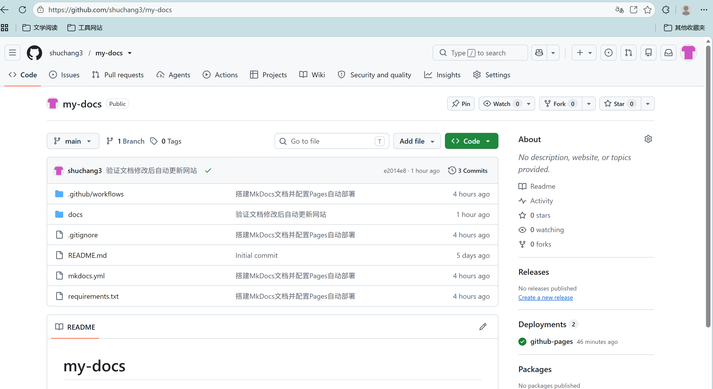
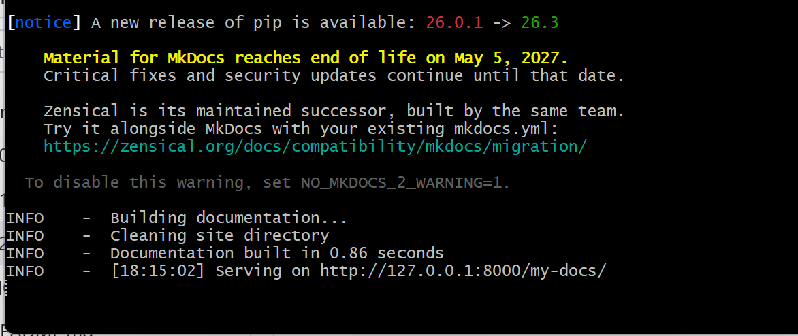
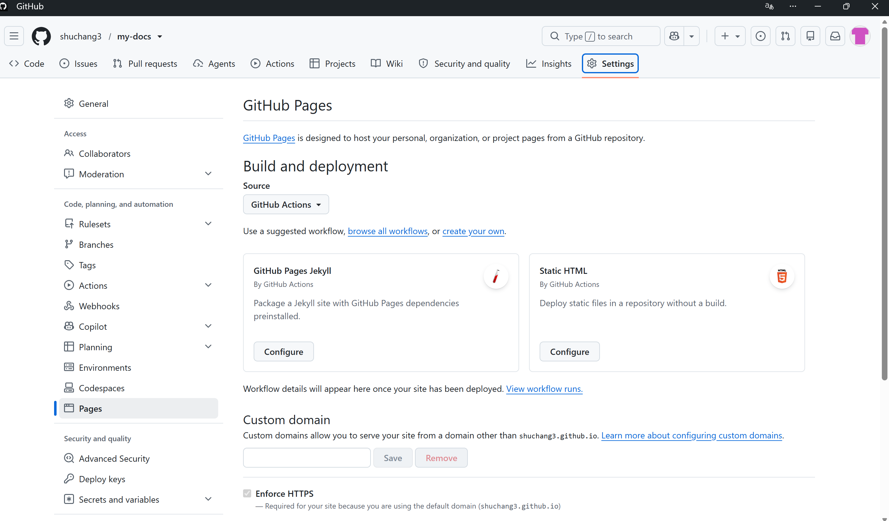
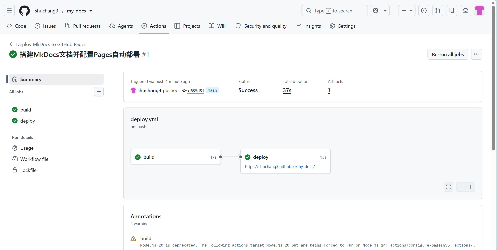
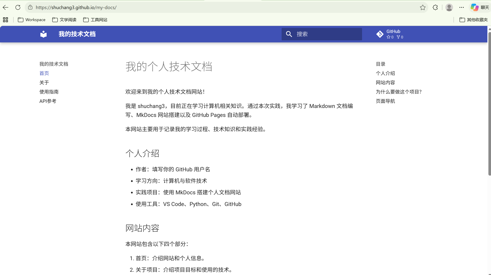
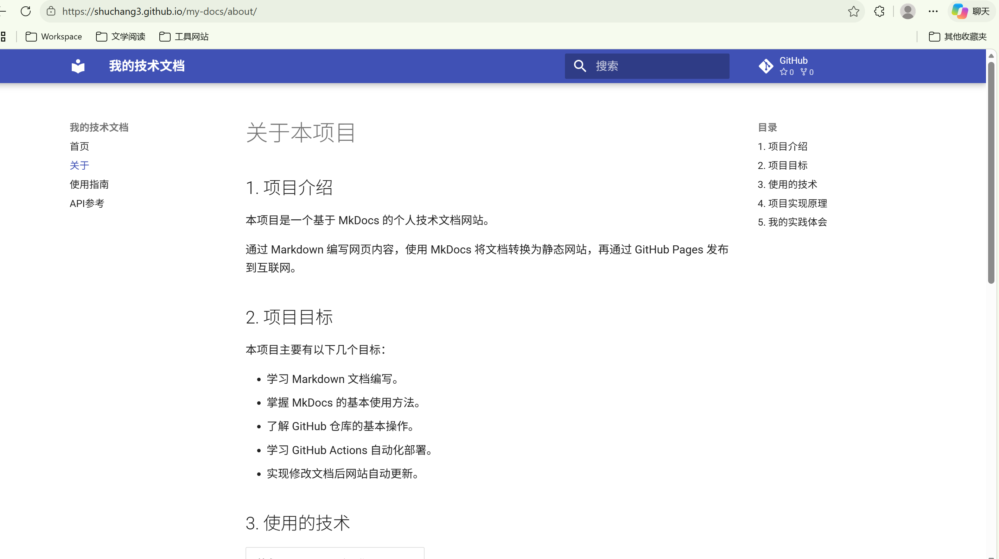
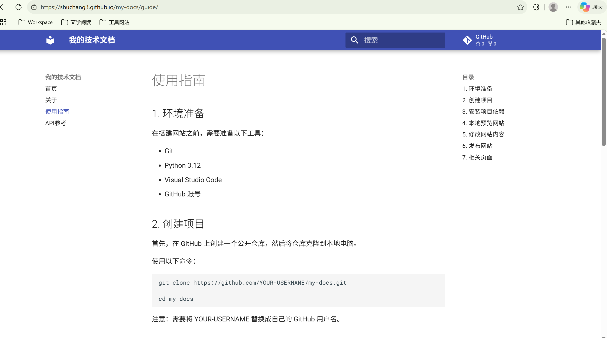
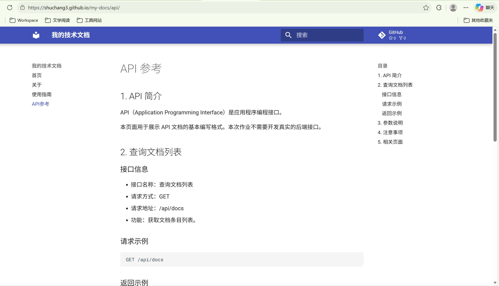
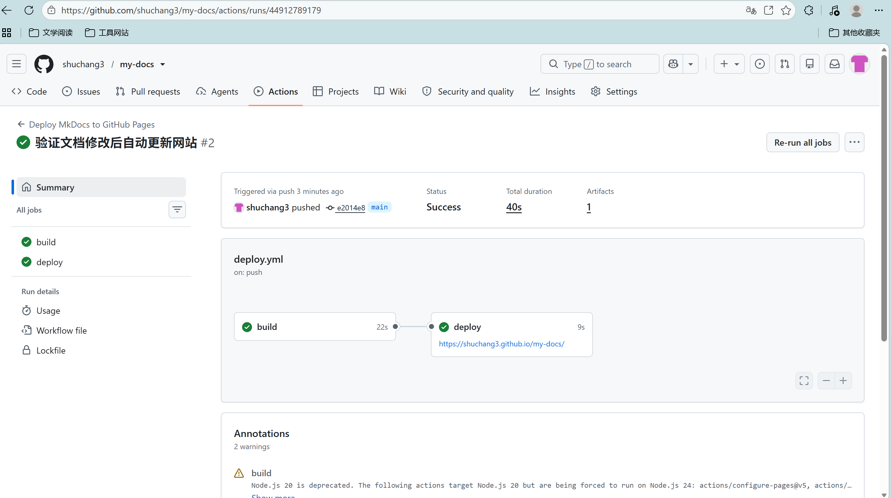
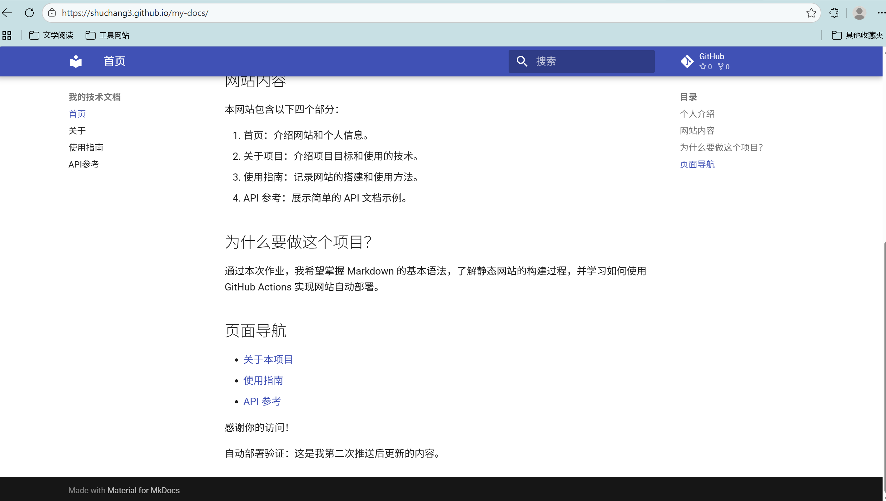

# 实践项目 2：个人实验报告

**实验名称：** 通过 GitHub Actions 自动部署 MkDocs 文档网站到 GitHub Pages  
**实验性质：** 个人实践  
**课程作业：** [02-github-pages：实践项目要求](https://github.com/hunnuOpenSourceSoftware2026/assignments/blob/main/02-github-pages.md)


## 1. 基本信息

| 项目 | 内容 |
| --- | --- |
| GitHub 登录名 | `shuchang3` |
| 个人公开仓库 | [https://github.com/shuchang3/my-docs/](https://github.com/shuchang3/my-docs/) |
| GitHub Pages 网站 | [https://shuchang3.github.io/my-docs/](https://shuchang3.github.io/my-docs/) |

### 1.1 实验目的

本次实验的目标是搭建一个包含四个页面的个人技术文档网站，并将网站的构建和发布过程自动化。具体包括：

1. 学习使用 Markdown 编写结构清晰的技术文档。
2. 使用 MkDocs 和 Material 主题把 Markdown 文件转换为静态网页。
3. 理解 `docs/` 源文件、`site/` 构建产物、GitHub Actions 工作流和 GitHub Pages 网站之间的关系。
4. 配置 GitHub Actions，实现将修改推送到 `main` 后自动构建、部署和更新网站。
5. 通过仓库提交记录、Actions 运行记录、网页截图验证实验结果。

### 1.2 实验思路

整个实验按照“**编辑 Markdown → 本地预览 → Git 提交与推送 → Actions 构建 → Pages 部署 → 浏览器验证**”的顺序进行。在网站首次发布后，再对首页做一次明确的修改，通过第二次推送检查自动更新是否生效。

---

## 2. 实践过程与关键截图

### 2.1 仓库创建

**操作过程：**

1. 使用个人 GitHub 账号登录 GitHub，选择 `New repository` 创建新仓库。
2. 将仓库命名为 `my-docs`，选择 **Public**，并使用 `main` 作为默认分支。
3. 在仓库页面复制 HTTPS 地址，将远程仓库克隆到本地。
4. 使用 VS Code 打开本地项目文件夹，后续统一在该目录中编辑项目。

**主要命令：**

```bash
git clone https://github.com/shuchang3/my-docs.git
cd my-docs
git branch --show-current
```



### 2.2 项目结构与 MkDocs 配置

本次实验将网站内容、自动部署配置和实验报告分开存放，以便维护与检查。按课程要求整理后的项目结构如下：

report\images\02.png

**主要目录和文件的作用：**

| 路径 | 作用 |
| --- | --- |
| `docs/` | 存储四个 Markdown 源文件，是网站页面内容的主要修改位置 |
| `mkdocs.yml` | 设置网站名称、主题、网址和 `nav` 导航顺序 |
| `requirements.txt` | 声明 MkDocs 及 Material 主题的依赖 |
| `.github/workflows/deploy.yml` | 指定自动化构建和部署的触发条件与执行步骤 |
| `site/` | 执行 MkDocs 构建命令后自动生成的静态网站文件 |
| `report/` | 存放个人实验报告和步骤截图，不作为网站页面源码 |

其中，`docs/` 保存需要人工维护的文档内容，而`site/` 保存由 MkDocs 自动生成的 HTML、CSS 等构建产物。`site/` 可以重新生成，因此应写入 `.gitignore`，不必手工修改，也不必提交到 `main` 分支。

**MkDocs 配置的关键部分：**

```yaml
site_name: 我的技术文档
site_url: https://shuchang3.github.io/my-docs/
repo_url: https://github.com/shuchang3/my-docs

theme:
  name: material
  language: zh

nav:
  - 首页: index.md
  - 关于: about.md
  - 使用指南: guide.md
  - API参考: api.md
```

这里的 `nav` 指定网站导航栏显示的页面名称及顺序，路径相对于 `docs/` 目录，不需要加上 `docs/` 前缀。

在文档内容方面，四个页面分别承担首页介绍、项目背景、操作指南和 API 示例的作用。其中，关于页使用表格说明技术组成，使用指南包含命令代码块，页面之间使用 Markdown 链接连接。

### 2.3 本地构建或预览

**操作过程：**

在项目目录下安装依赖，通过 MkDocs 执行构建和本地预览。

```bash
python -m pip install -r requirements.txt
python -m mkdocs build --strict
python -m mkdocs serve
```

其中：

- `python -m mkdocs build --strict` 用于生成 `site/`，并在构建出现警告时严格检查。
- `python -m mkdocs serve` 用于启动本地开发服务器；浏览器通常访问 `http://127.0.0.1:8000/`。
- 修改 `docs/*.md` 并保存后，本地预览通常能够自动重新加载，便于检查页面内容。

**实际过程记录：** 我已经能够通过本地网址打开文档网站。在开始修改时，曾不清楚网页内容应该在哪里编辑；查看项目结构后，了解到应在 VS Code 中修改 `docs/` 下的 Markdown 文件，而不是直接在浏览器中修改。编辑后保存并查看预览，可以检查标题、导航和排版。

**构建命令结果：** 




### 2.4 GitHub Pages 设置

**操作过程：**

1. 进入个人仓库的 `Settings`。
2. 点击左侧 `Pages`。
3. 在 `Build and deployment` 中将 `Source` 设为 **GitHub Actions**。
4. 检查仓库允许使用所需的 GitHub Actions 工作流。

**配置原因：** 本实验使用 GitHub 官方的 Pages Actions 部署方式，由工作流构建 `site/` 并上传部署产物。




### 2.5 GitHub Actions 首次构建和部署

**工作流文件：** `.github/workflows/deploy.yml`

工作流设置为：向 `main` 分支推送 `docs/**`、`mkdocs.yml`、`requirements.txt` 或工作流文件本身的更改时自动运行；另外也可以使用 `workflow_dispatch` 从 Actions 页面手动触发。

首次运行主要分为两个任务：

1. **`build`：** 检出仓库代码，配置 Python 3.12，安装依赖，执行 `python -m mkdocs build --strict`，再使用 `actions/upload-pages-artifact` 上传 `site/` 目录。
2. **`deploy`：** 在 `build` 成功后，使用 `actions/deploy-pages` 将构建产物发布到 GitHub Pages。此任务使用 `pages: write` 和 `id-token: write` 等部署权限。

**运行记录：**

| 项目 | 记录 |
| --- | --- |
| 运行名称 | 搭建MkDocs文档并配置Pages自动部署 |
| 触发方式 | 向 `main` 分支 `push` |
| 首次提交 | `d635d81` |
| 运行状态 | **Success** |
| 工作流任务 | `build` 和 `deploy` 均完成 |
| 运行链接 | [第一次部署记录](https://github.com/shuchang3/my-docs/actions/runs/44894030387) |

这次成功运行说明工作流能够完成网站构建和 Pages 部署，而不需要手工上传构建后的网页文件。



### 2.6 网站访问与四页导航检查

部署记录给出的网站地址为：

**https://shuchang3.github.io/my-docs/**

网页的主要检查项目如下：

| 页面 | 对应文件 | 需要检查的内容 | 本人检查结果 |
| --- | --- | --- | --- |
| 首页 | `docs/index.md` | 网站标题、个人介绍、页面入口 | 正常 |
| 关于 | `docs/about.md` | 项目介绍和 Markdown 表格 | 正常 |
| 使用指南 | `docs/guide.md` | 搭建步骤与命令代码块 | 正常|
| API 参考 | `docs/api.md` | API 示例和代码格式 | 正常 |










### 2.7 第二次推送与自动更新验证

**验证目的：** 仅有首次部署成功还不足以说明“修改文档后能够自动更新”。因此需要在首次部署后修改网页内容，再推送一次，观察工作流是否由 `push` 自动触发。

**修改内容：** 在 `docs/index.md` 中增加了下面这句容易辨认的文字：

> 自动部署验证：这是我第二次推送后更新的内容。

随后提交并推送到 `main` 分支。该提交与第二次运行的记录如下：

- **对应提交链接：** [查看第二次提交 e2014e8](https://github.com/shuchang3/my-docs/commit/e2014e8eaa0c72f24564c7a9023fd7ec0502aa20)
- **对应 Actions 运行链接：** [查看第二次自动部署](https://github.com/shuchang3/my-docs/actions/runs/44912789179)

GitHub 的提交记录能确认首页源文件中新增了这句话，Actions 记录能确认第二次推送触发的构建与部署已成功。最后还需本人打开公开网站刷新，确认该文字已经出现在网页上，才能完整证明从源文件修改到公开网站更新的全过程。






---

## 3. 问题与解决

### 3.1 不知道如何修改本地预览的网站内容

**问题现象：** 初次能够通过本地地址打开 MkDocs 网站时，我对网页显示的文字与项目文件之间的关系不够熟悉，不知道该修改哪个文件。

**原因分析：** 浏览器显示的是 MkDocs 根据 Markdown 文件构建或预览的结果。网页不是本次项目的直接编辑入口，真正需要维护的是 `docs/` 目录中的源文件。

**解决过程：** 在 VS Code 中打开项目，找到 `docs/index.md`、`docs/about.md`、`docs/guide.md` 和 `docs/api.md`，根据页面内容修改对应文件。保存后，通过本地预览观察变化。

### 3.2 Actions 中出现 Node.js 版本弃用警告

**实际现象：** 我查看两次 GitHub Actions 运行摘要时，发现其中存在有关 Node.js 20 弃用的警告；部分 Actions 被强制使用 Node.js 24 执行。

**分析与处理：** 这属于依赖 Action 运行环境的兼容性提醒，并非本次 MkDocs 构建失败的错误。首次与第二次工作流的最终状态均为 `Success`，`build` 和 `deploy` 也都完成。因此，本次根据运行结果判断部署成功，同时保留该警告作为后续维护工作流时需要关注的问题，避免把警告误认为运行失败。

**相关日志：** [首次运行](https://github.com/shuchang3/my-docs/actions/runs/44894030387) / [第二次运行](https://github.com/shuchang3/my-docs/actions/runs/44912789179)

---

## 4. 原理理解

### 4.1 `docs/` 和 `site/` 各保存什么？为什么不用手工修改 `site/`？

`docs/` 保存我们自己编写的 Markdown 源文件，是网站内容的维护入口。例如修改首页介绍应编辑 `docs/index.md`。

`site/` 保存 MkDocs 构建生成的静态网页资源，例如 HTML、CSS 和 JavaScript。它相当于源文件经过构建后得到的“成品”。每次重新构建时，这些内容都可能被覆盖，所以手动修改 `site/` 既不方便维护，也不能可靠保留修改。正确做法是修改 `docs/`，然后重新构建，由工作流负责发布新的 `site/`。

### 4.2 本次工作流在什么情况下自动运行？

本次 `deploy.yml` 使用了 `push` 和 `workflow_dispatch` 两种触发方式。

- **自动触发：** 当修改 `docs/**`、`mkdocs.yml`、`requirements.txt` 或 `.github/workflows/deploy.yml`，并把更改推送到 `main` 分支时触发。
- **手动触发：** 可以在 GitHub Actions 页面通过 `workflow_dispatch` 主动运行工作流，适用于必要的重试或排错。

这样既可以保证与网站内容和构建配置相关的修改自动发布，也能避免某些无关更改造成重复部署。

### 4.3 `build` 与 `deploy` 两个任务有什么区别？

`build` 负责把仓库中的 Markdown 和配置转换为能够发布的网站文件。它包括检出代码、配置 Python、安装依赖、运行 MkDocs 和上传 Pages 构建产物。

`deploy` 负责把构建产物发布到 GitHub Pages，让用户能够通过公开网址访问。工作流使用 `needs: build` 指定先后依赖，因此只有构建任务成功后才会执行部署任务。

简单理解就是：**`build` 负责生成网站，`deploy` 负责发布网站。**

### 4.4 只修改 `report/README.md` 会触发部署吗？为什么？

**不会自动触发。** 本次工作流在 `push` 事件下配置了 `paths` 文件路径过滤，只有指定的 `docs/**`、`mkdocs.yml`、`requirements.txt` 和工作流配置文件发生变动时才自动运行。

`report/README.md` 不在这份路径列表中，因此如果一次推送只修改实验报告或截图，而没有改动以上文件，就不会启动新的自动部署。这不影响报告文件被提交到 GitHub 仓库，也不代表工作流出现问题。需要注意，如果一次推送同时修改了报告和 `docs/`，仍然会触发部署。

### 4.5 本次方案为何无需创建 `gh-pages` 分支？

因为本实验使用的是 GitHub 官方 Pages Actions 部署方案，而不是传统的“将生成文件推送到 `gh-pages` 分支”方案。

在官方方案中，`build` 任务通过 `actions/upload-pages-artifact` 上传 `site/` 构建产物，`deploy` 任务通过 `actions/deploy-pages` 把产物直接发布到 GitHub Pages。GitHub Pages 的发布来源设置为 **GitHub Actions**，因此不需要另外创建或维护 `gh-pages` 分支，也不必在 `main` 中保存生成的 `site/`。

---

## 5. 实践总结与体会

通过本次实验，我对 Markdown 文档、静态网站和自动部署之间的联系有了更具体的理解。开始时，我能够访问本地网页，却不清楚应该在哪里修改网页文字；后来通过查看项目结构，我认识到 `docs/` 中的 Markdown 文件才是网站的内容来源，而浏览器只是显示预览或发布后的效果。

在项目组织方面，我学习了使用 `mkdocs.yml` 管理导航和主题，通过 `requirements.txt` 保持构建环境所需的依赖，并使用 `.gitignore` 排除可重新生成的文件。相比直接修改 HTML，使用 Markdown 编写文档更便于维护，也适合技术笔记和项目说明。

在 GitHub Actions 部署方面，最重要的收获是理解了“提交源码”和“发布网页”之间不再需要手工操作。查看第一次及第二次成功运行记录后，我能够将每次 `push`、`build`、`deploy` 及对应的提交联系起来；第二次修改首页的实验进一步说明了自动更新功能如何验证。

我还认识到，判断自动化任务是否正常，不能只看日志里有没有警告，而要结合具体任务状态、构建产物和最终网页效果来分析。以后进行类似的开发实践时，我会更重视文件结构、提交记录、工作流日志以及可复现的截图证据。

